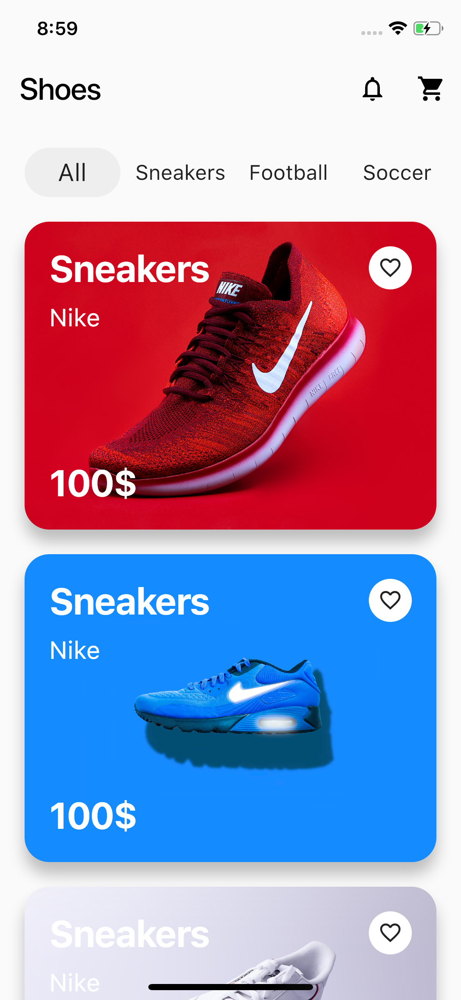
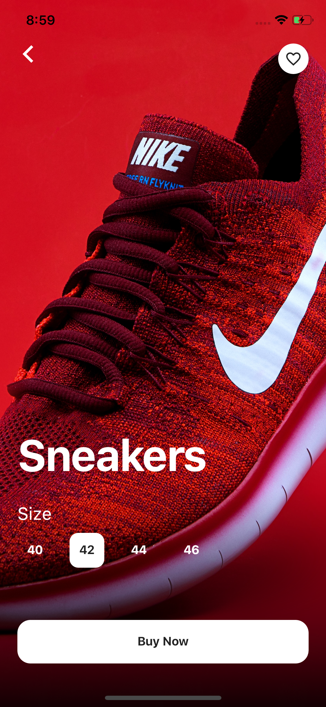
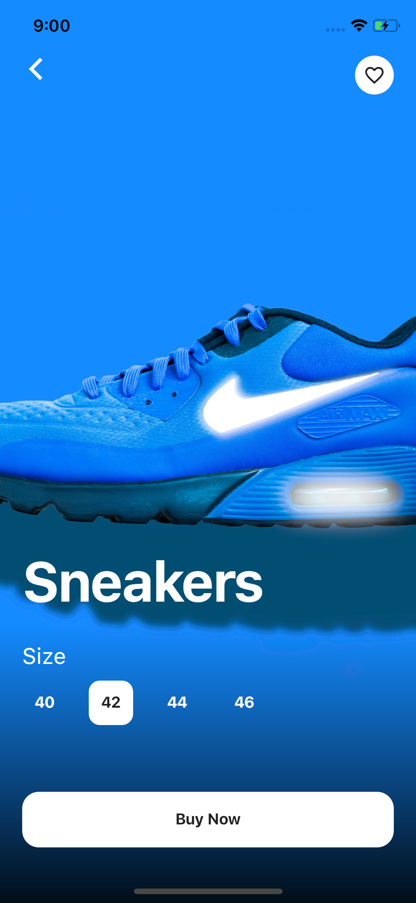
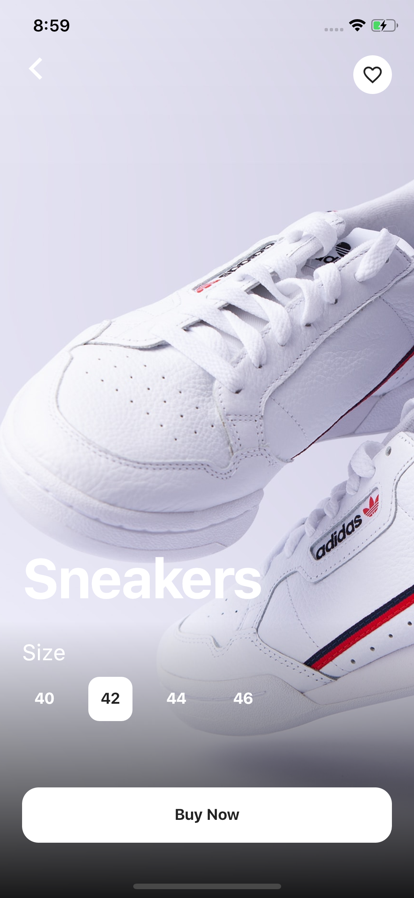

# ShoesShopApp

Aplicación móvil de estilo e-commerce para la compra de calzado, desarrollada con Flutter. La app presenta una interfaz visual moderna, navegación por categorías, detalle de producto con selección de talla y flujo de compra, todo con animaciones suaves y un diseño inspirado en tiendas de moda urbana.

## Descripción general

ShoesShopApp es una UI de tienda de zapatos diseñada para mostrar productos, filtrar por tipo de calzado y permitir una experiencia visual amigable para clientes que navegan ofertas, categorías y detalles de cada artículo. El proyecto está orientado a demostrar buenas prácticas de diseño en Flutter combinado con animaciones y widgets reutilizables.

La aplicación incluye:

- Catálogo principal de productos
- Navegación por categorías: Sneakers, Football, Running y Air
- Vista de detalle del producto con selección de talla
- Animaciones de entrada y transición entre pantallas
- Diseño visual premium con imágenes de alto impacto
- Uso de widgets personalizados y arquitectura simple por pantallas

## Capturas de pantalla

<div align="center">
  
  
  
  
</div>

## Arquitectura y estructura del proyecto

La estructura principal del repositorio es la siguiente:

```text
ShoesShopApp/
├── android/
├── ios/
├── assets/
│   ├── images/
│   └── screenshot/
├── lib/
│   ├── Animation/
│   │   └── FadeAnimation.dart
│   ├── pages/
│   │   ├── homepage.dart
│   │   ├── Shoes.dart
│   │   ├── buypage.dart
│   │   ├── sneakers.dart
│   │   ├── football.dart
│   │   ├── running.dart
│   │   └── air.dart
│   └── widgets/
│       ├── cab.dart
│       ├── custombutton.dart
│       └── const.dart
├── test/
├── .gitignore
├── LICENSE
├── pubspec.yaml
├── pubspec.lock
└── README.md
```

### Componentes clave

- `lib/main.dart`: punto de entrada de la aplicación. Inicia la app con `HomePage`.
- `lib/pages/homepage.dart`: pantalla principal del catálogo con categorías y listado de productos.
- `lib/pages/Shoes.dart`: pantalla de detalle del producto, con selección de talla y botón de compra.
- `lib/pages/buypage.dart`: pantalla de compra/checkout de ejemplo.
- `lib/Animation/FadeAnimation.dart`: animación reutilizable para entradas de elementos con efecto fade/translate.
- `lib/widgets/custombutton.dart`: botón personalizado de la app.
- `lib/widgets/cab.dart`: widget auxiliar para elementos de tamaño/selección de talla.

## Dependencias principales

El proyecto usa Flutter con las siguientes dependencias relevantes:

- `flutter`: SDK base
- `cupertino_icons`: iconos de iOS
- `simple_animations`: animaciones visuales
- `get`: gestión de navegación y estado de manera ligera

El archivo `pubspec.yaml` define el entorno de ejecución y las dependencias del proyecto.

## Paquetes y librerías

### Flutter SDK

La app se construye completamente con Flutter, aprovechando el sistema Material para pantallas, botones, navegación y edición visual.

### GetX

Se usa `get` para simplificar la navegación entre pantallas, reduciendo el código repetitivo de `Navigator` y facilitando transiciones.

### Simple Animations

El paquete `simple_animations` permite animaciones suaves como fade-in y desplazamiento vertical para los elementos del catálogo y las pantallas de detalle.

## Flujo de la experiencia de usuario

1. El usuario ingresa a la pantalla principal `HomePage`.
2. Explora categorías como sneakers, running, football y air.
3. Elige un producto del listado.
4. Se despliega la vista de detalle con imagen en grande y opciones de talla.
5. Puede confirmar la compra desde la pantalla de compra (`BuyPage`).

## Requisitos

Antes de ejecutar el proyecto, asegúrate de tener instalado:

- Flutter SDK 3.1 o superior
- Dart SDK compatible con Flutter
- Android Studio o VS Code con extensiones de Flutter
- Dispositivo físico o emulador configurado

## Cómo ejecutar la app

Clona el repositorio:

```bash
git clone https://github.com/YaelHuerta1/ShoesShopApp.git
cd ShoesShopApp
```

Instala las dependencias:

```bash
flutter pub get
```

Ejecuta la aplicación:

```bash
flutter run
```

Si deseas ejecutar en un dispositivo específico:

```bash
flutter devices
flutter run -d <device_id>
```

## Modo de desarrollo

Para compilar la app en modo de producción:

```bash
flutter build apk
```

O para iOS:

```bash
flutter build ios
```

## Notas del proyecto

Este repositorio está orientado más bien a una demostración de UI y animaciones para una tienda de calzado que a un backend completo. No incluye integración con APIs ni persistencia de datos reales; su propósito principal es presentar una experiencia visual completa y atractiva para un marketplace móvil.

## Licencia

Este proyecto se distribuye bajo la licencia MIT. Consulta el archivo `LICENSE` para más detalles.

## Créditos

Proyecto desarrollado como una app de catálogo y compra de calzado con Flutter y diseño visual moderno.

## Screenshots adicionales

```text
assets/screenshot/1.png
assets/screenshot/2.png
assets/screenshot/3.png
assets/screenshot/4.png
assets/screenshot/11.png
assets/screenshot/12.png
assets/screenshot/13.png
assets/screenshot/14.png
assets/screenshot/15.png
assets/screenshot/16.png
assets/screenshot/17.png
assets/screenshot/18.png
assets/screenshot/one.png
assets/screenshot/two.png
assets/screenshot/three.png
assets/screenshot/four.png
```

Estas imágenes forman parte de la galería de diseño visual de la app y se mantienen como recursos de presentación del proyecto.
